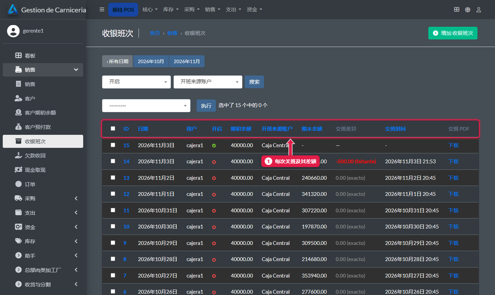
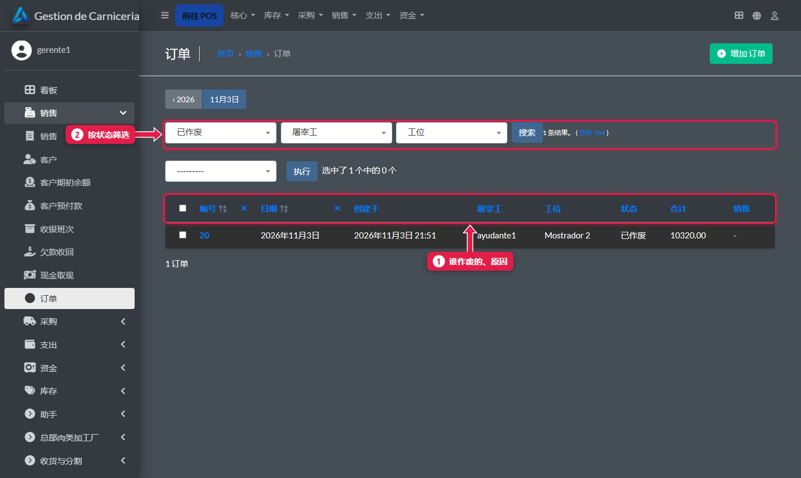
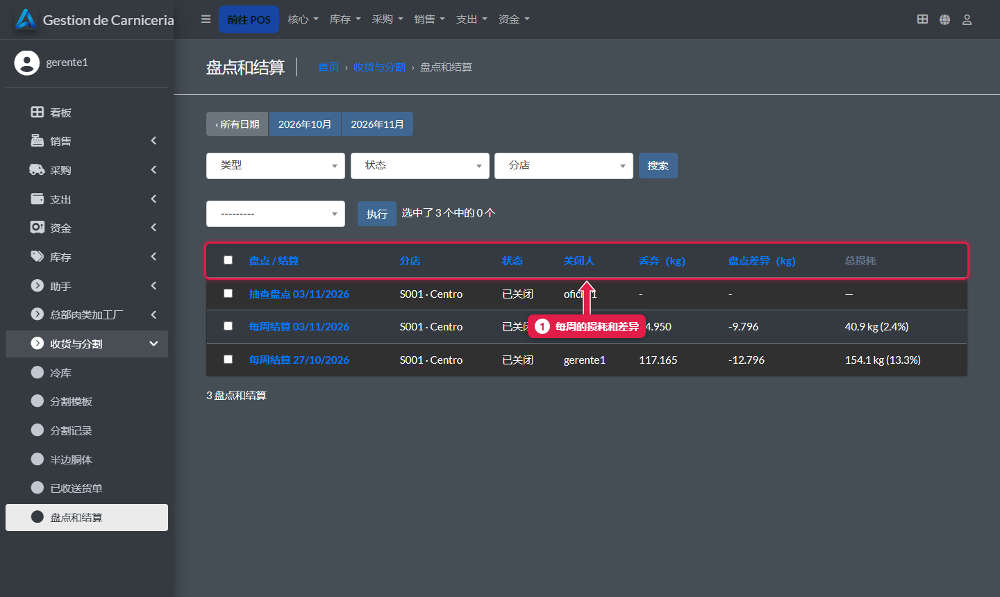
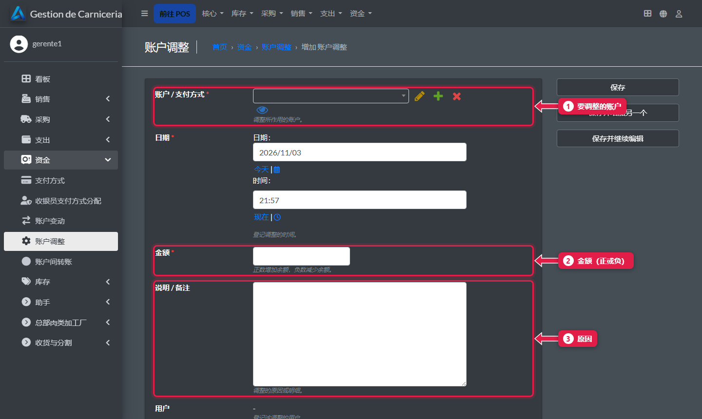

# 每周检查：收银差额、作废订单和损耗

> **适合谁：** 分店经理。  **时间：** 每周 15 分钟。

每周在后台检查三件事：**收银差额**、**作废的订单**和**结算的损耗**。收银错误用**账户调整**更正。

## 有什么用
每天都少一点钱，或者同一个人作废了很多订单——这些信号只有看整周才能发现。

## 操作步骤

### 1. 收银差额
**销售 → 收银班次**。

1. 每次交班的**期初余额**、**期末余额**、**交班差额**（短款显示红色）和交班 **PDF**。打开班次可以看收银员写的**原因**。

### 2. 作废的订单
**销售 → 订单**，按状态筛选**已作废**。

1. 每张作废的订单，显示**谁**作废的和**原因**。
2. **按状态筛选：** 未结、已收款或已作废。

### 3. 结算的损耗
**收货与分割 → 盘点和结算**。

1. 每次结算的**损耗**和**差额**。损耗超过 **6%** 就要找原因：肉放太久、分割没录入或订单公斤数输错。

### 4. 更正收银错误：账户调整
**资金 → 账户调整 → 添加**。

1. 要调整的**账户**（例如现金或收银差额）。
2. **金额：** 正数增加，负数减少。
3. **说明：** 原因，一定要写。

## 系统在后台做了什么
- 已交班的班次不动：调整是一条新的记录，有据可查。

## 常见疑问

### 能直接修改已交班的班次来更正吗？
不建议：会丢失记录。用账户调整。

## 下一步
- 给加工厂：[总部面板](23-panel-central.md)。
