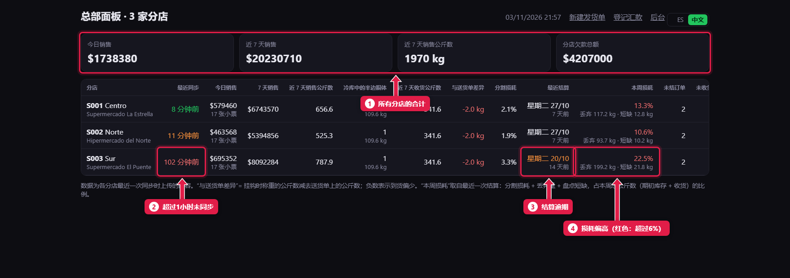
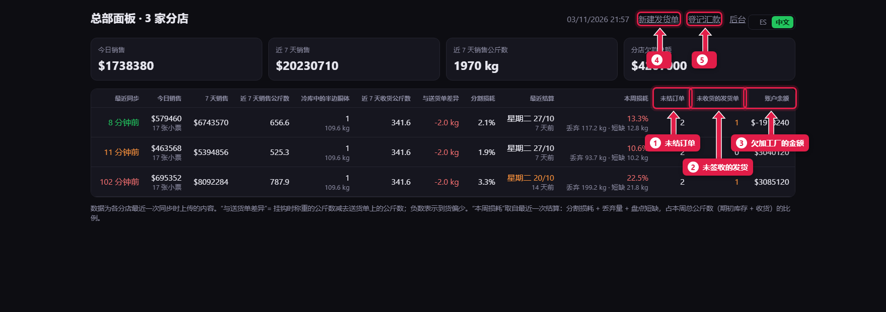

# 总部面板：各分店的情况

> **适合谁：** 加工厂。  **时间：** 每天早上 5 分钟。  **在哪里：** 总部服务器上的 `/central/`。

面板为**每家分店显示一行**，内容是各分店上传的数据：什么时候同步、卖了多少、多少公斤、冷库里挂着几个半边胴体、损耗和欠款。**橙色**或**红色**的数字是警示。每 2 分钟自动刷新。

## 有什么用
不用打电话就能同时看到所有肉店，及时发现电脑断网、结算逾期或损耗偏高。

## 操作步骤

### 1. 看警示

1. **合计：** 今天和近 7 天的销售、卖出的公斤数和所有分店的欠款总额。
2. **最近同步：** 绿色，不到 10 分钟；橙色，10 到 60 分钟；**红色，超过 1 小时**：电脑关了或断网了。
3. **最近结算：** 超过 **8 天**或从未结算显示橙色。
4. **本周损耗：** 最近一次结算的损耗（分割 + 丢弃 + 短少）。超过 4% 橙色，**超过 6% 红色**。下面是丢弃和短少的公斤数。

### 2. 右侧几栏

1. 此刻的**未结订单**。
2. **未收货的发货单：** 分店还没确认的。
3. **账户余额：** 分店欠加工厂的钱。
4. **新建发货单**（[教程 24](24-despachar-a-una-sucursal.md)）。
5. **登记汇款**（[教程 25](25-cuenta-corriente-de-sucursales.md)）。

## 每一栏看什么
| 栏目 | 看什么 |
|---|---|
| 今天 / 近 7 天销售 · 卖出公斤数 | 和其他分店比，和上周比 |
| 冷库中的半边胴体 | 还挂着几个、多少公斤 |
| 收货公斤数和**与送货单的差额** | 挂起时称的公斤数减去出厂重量。少了超过 1 公斤显示红色 |
| 分割损耗 | 超过 4% 显示橙色 |

## 常见问题
| 遇到…… | 原因…… | 怎么办 |
|---|---|---|
| 某分店*最近同步*是红色 | 电脑关了或断网 | 打电话给分店。期间它照常营业，恢复后上传全部数据 |
| 今天的数字不变 | 分店没在同步 | 同上 |

## 常见疑问

### 总部能修改分店的销售吗？
不能。数据在哪里录入就在哪里改：销售在分店改。总部改了销售，分店收不到。

## 下一步
- [给分店发货](24-despachar-a-una-sucursal.md)。
