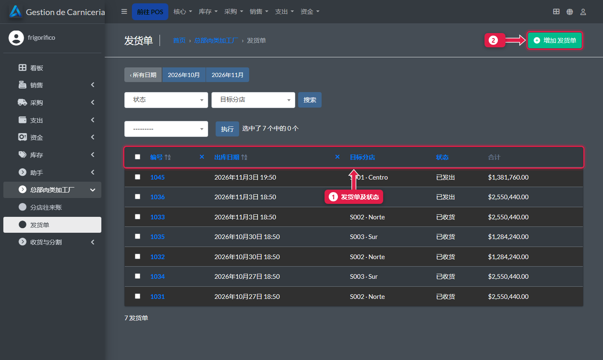
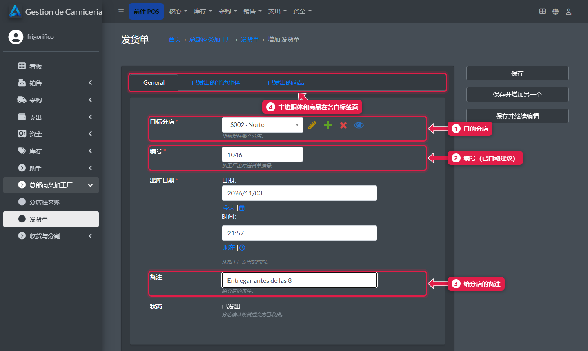
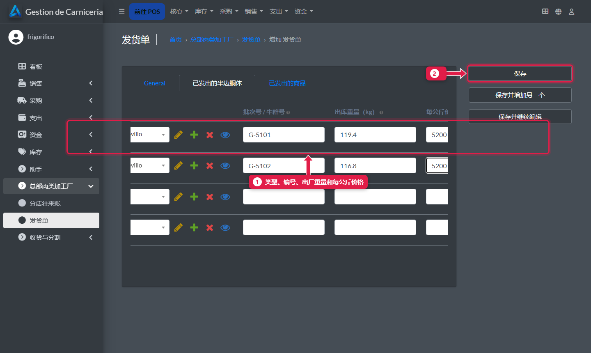
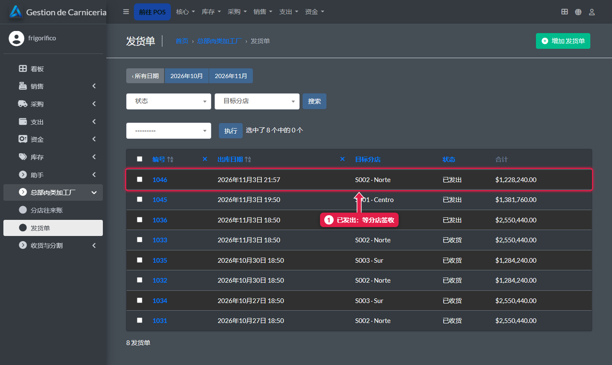

# 给分店发货

> **适合谁：** 加工厂。  **时间：** 5 分钟。  **在哪里：** 总部后台 → **总部肉类加工厂 → 发货单**。

创建一张**发货单**：目的分店，每个**半边胴体**一行（类型、编号、出厂重量和每公斤价格），以及**其他商品**。保存后，分店的欠款自动增加。下一分钟，分店就在**待收货的发货单**里看到它。

## 有什么用
分店收到的发货单全都预先填好：只需称重和确认。往来账也自动更新，不用手工记账。

## 操作步骤

### 1. 打开发货单

1. **发货单**的日期、分店、状态（**已发出**或**已收货**）和合计。
2. **添加发货单。**

### 2. 填写基本信息

1. **目的分店。**
2. **编号：** 系统建议下一个号码。
3. **备注：** 给分店的话，例如“8 点前送到”。
4. **半边胴体**和**商品**在各自的标签页。

### 3. 录入半边胴体
**已发出的半边胴体**标签页。

1. 每个半边胴体一行：**类型**（模板，例如 Media res novillo 阉牛半边胴体）、**编号**、**出厂重量**和**每公斤价格**（给分店的调拨价）。
2. 有鸡肉、香肠等就填**已发出的商品**标签页，然后点**保存**。

### 4. 发货单已发出

1. 分店收货前一直是**已发出**。

## 系统在后台做了什么
- 发货单**合计**（半边胴体公斤 × 价格 + 商品）作为**欠款**记入分店账户。修改发货单时，欠款会自动调整。
- 下次同步时，分店就能收货（[教程 11](11-recibir-despacho-del-frigorifico.md)）。
- 分店确认后变成**已收货**，实际重量进入总部面板。

## 常见问题
| 遇到…… | 原因…… | 怎么办 |
|---|---|---|
| 分店看不到发货单 | 它的电脑没同步 | 看[面板](23-panel-central.md)上的*最近同步* |
| 重量或价格写错了 | — | 在分店收货前修改发货单：欠款会重新计算 |

## 下一步
- [分店往来账](25-cuenta-corriente-de-sucursales.md)。
