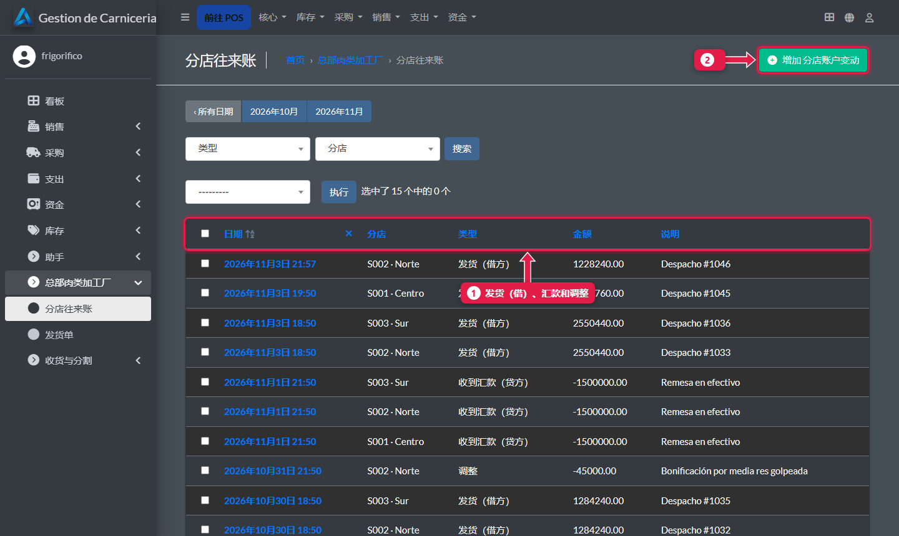
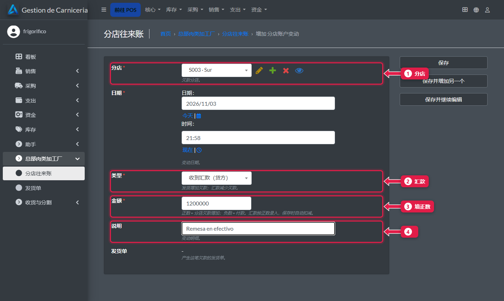
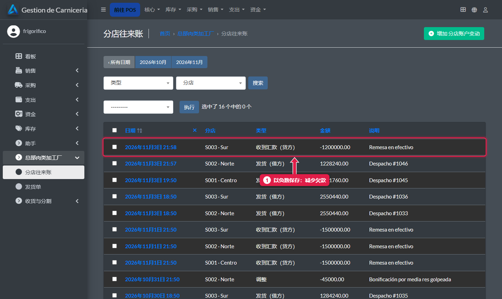

# 分店往来账：汇款和调整

> **适合谁：** 加工厂。  **时间：** 1 分钟。

每家分店**欠**发给它的货款，用**汇款**来**还**。收到汇款时，在**分店往来账 → 添加**里登记，类型选**汇款**，金额填**正数**：系统会从欠款里扣掉。

## 三种账目
| 类型 | 是什么 | 怎么录入 |
|---|---|---|
| **发货（借方）** | 发出的货 | 保存发货单时**自动**生成 |
| **收到汇款（贷方）** | 分店汇来的钱 | 手动，填正数：保存时自动变成减项 |
| **调整** | 更正（例如折让） | 手动：正数增加欠款，负数减少。一定要写说明 |

## 操作步骤

### 1. 查看账目

1. 所有分店的**发货、汇款和调整**。可以按分店筛选。
2. **添加**一条账目。

### 2. 登记汇款

1. **分店。**
2. **类型：** 收到汇款。
3. **金额：** 正数。
4. **说明：** 例如“现金汇款”。点**保存**。

### 3. 汇款减少欠款

1. 保存为**负数**：余额减少。各分店的余额在[面板](23-panel-central.md)的**账户余额**一栏。

## 常见疑问

### 发货单要在这里录吗？
不用：保存发货单时会自动生成。

## 下一步
- [商品目录：商品、价格、照片和模板](26-catalogo-precios-y-plantillas.md)。
