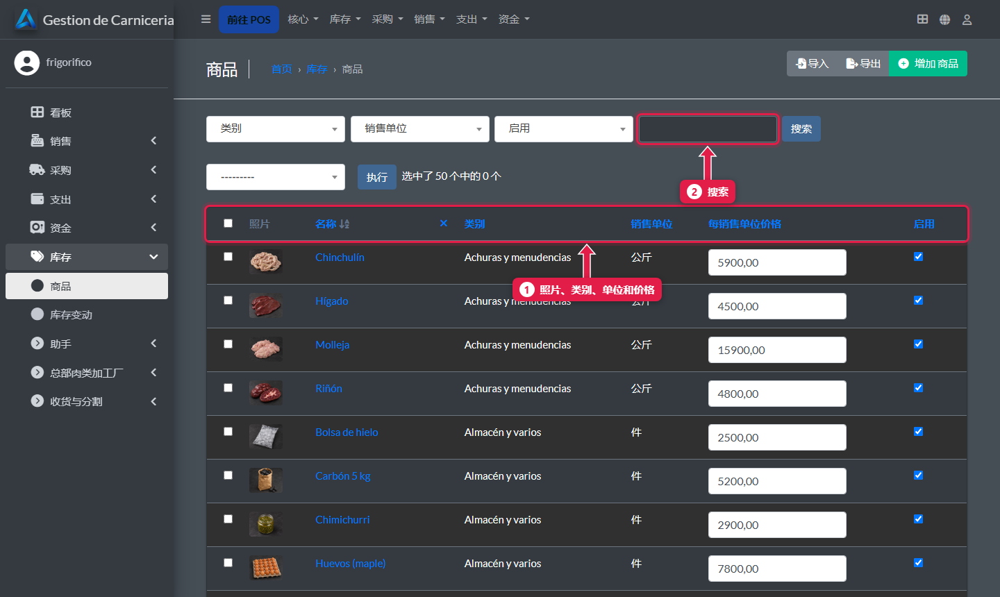
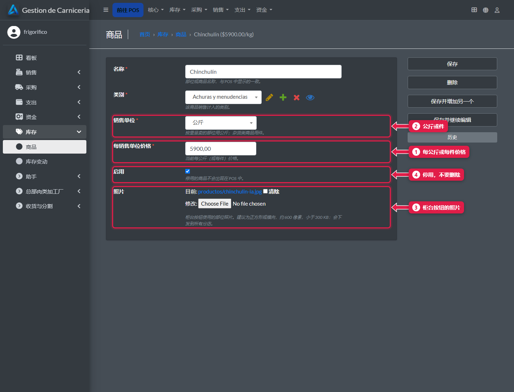
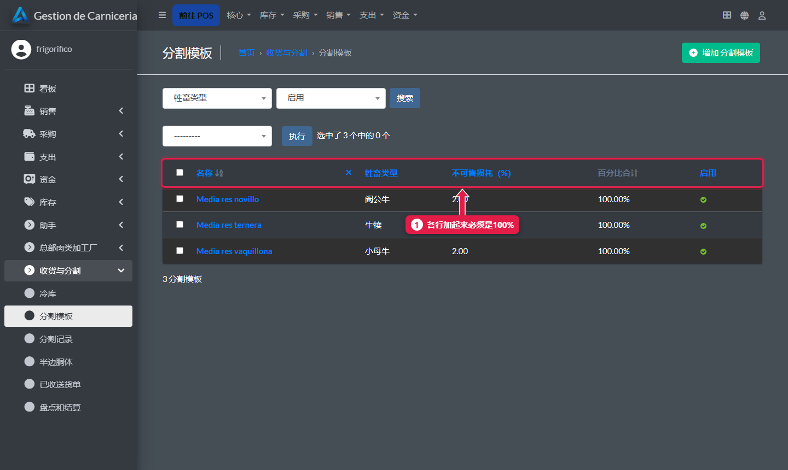
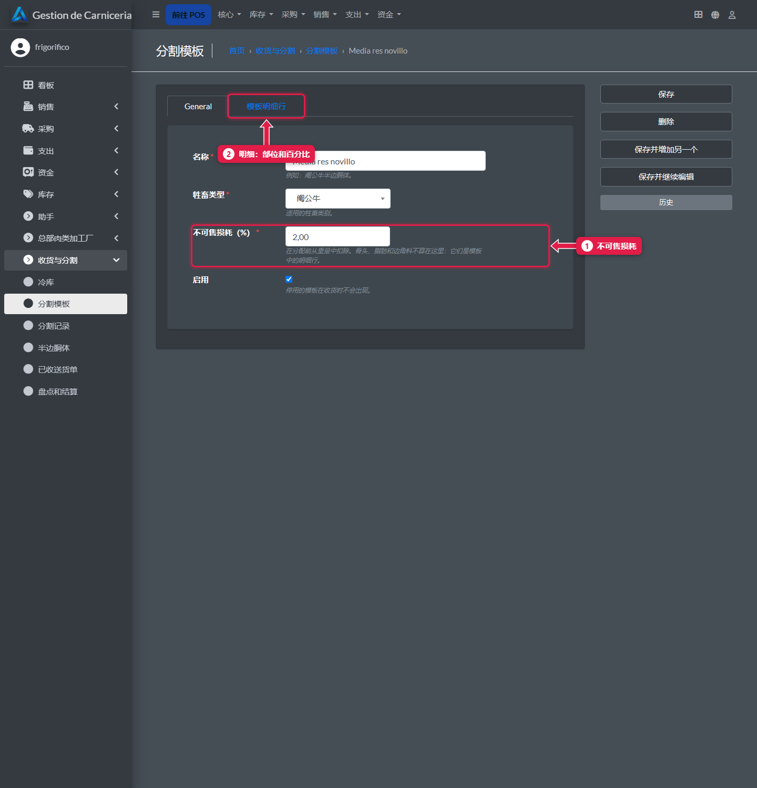
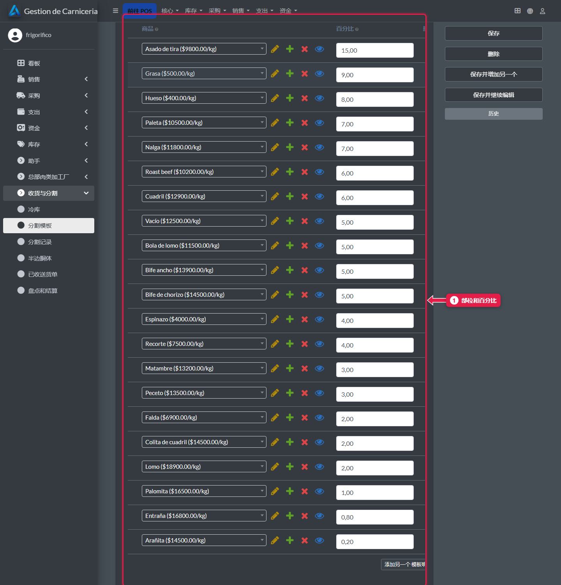

# 商品目录：商品、价格、照片和分割模板

> **适合谁：** 加工厂。  **时间：** 每个商品 2 分钟。

**商品**、**价格**、**照片**、**类别**和**分割模板****只在总部录入**。每次修改都会在下次同步时下发到所有分店。

## 有什么用
价格只在一个地方管理：所有肉店卖同样的价格，柜台上的按钮也一样。

## 操作步骤

### 1. 商品
**库存 → 商品**。

1. 每个商品的**照片**、**类别**、**单位**和**价格**。
2. 按名称**搜索**。

### 2. 编辑商品

1. **价格：** 每公斤或每件。
2. **单位：** **kg**（在柜台称重）或**件**（数个数）。
3. **照片：** 柜台按钮上的照片。最好是横向的，约 600 像素，小于 300 KB。
4. **启用：** 不再卖的商品**停用**，不要删除。

### 3. 分割模板
**收货与分割 → 分割模板**。

1. 每个模板的**损耗**和**百分比合计**。各行加起来必须是 **100%**：否则会标上 ⚠。

1. **损耗：** 卖不掉的重量百分比（例如 2%）。
2. **明细**标签页：每行一个部位。

1. 每个**部位**及其占去损耗后重量的**百分比**。例如：Asado de tira（肋排）15%，Vacío（腹肉）5%。

## 系统在后台做了什么
- 修改在下一分钟下发到所有分店。
- 分店在自己的电脑上改了价格，修改**不会上传**，下次总部修改这个商品时就会丢失。
- 分割时模板这样计算每个部位的公斤数：`重量 × (1 − 损耗%) × 部位百分比`。

## 常见疑问

### 各分店能有不同的价格吗？
这个版本不能：所有分店同一个价格。

## 下一步
- [开设新分店](27-abrir-una-sucursal-nueva.md)。
