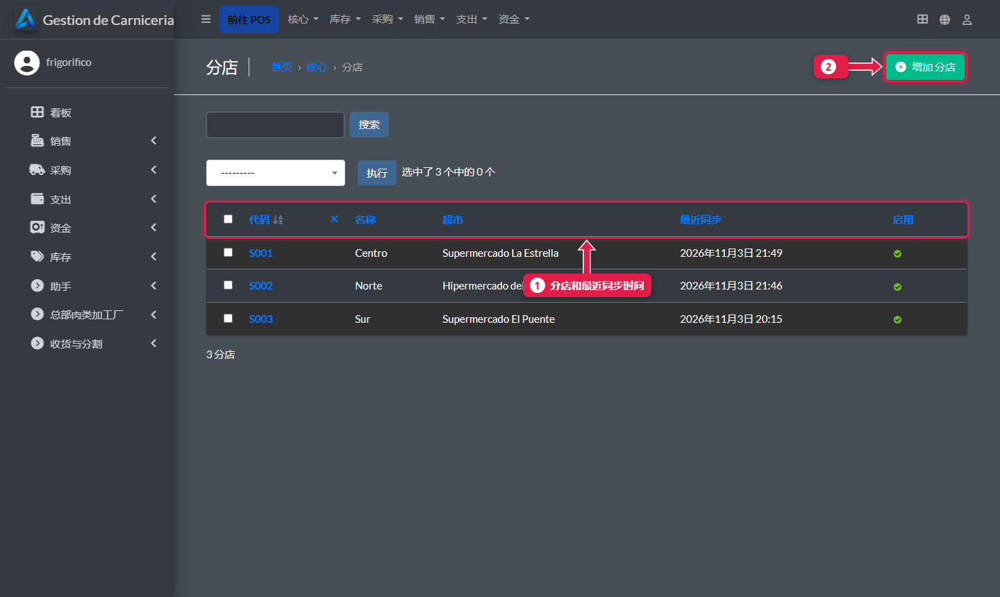
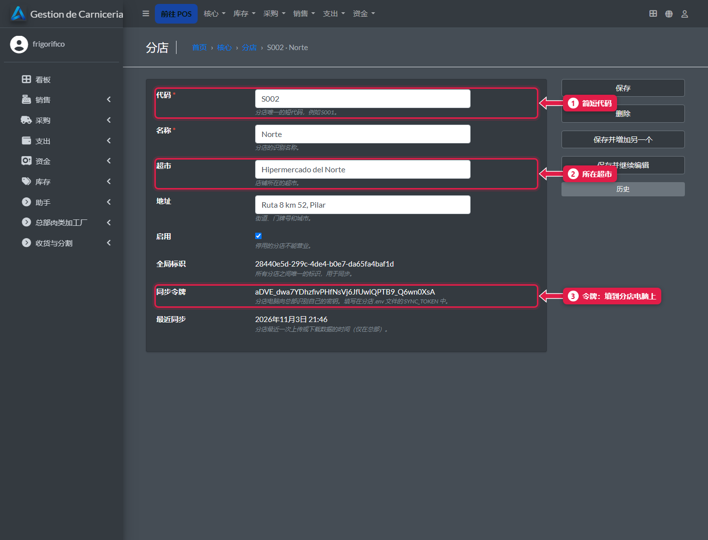

# 开设新分店

> **适合谁：** 加工厂和负责安装的人。  **时间：** 30 分钟。

先在**总部**创建分店（会生成它的**同步令牌**）。然后在**分店电脑**上安装系统，填入这个令牌。第一分钟就会下载全部商品目录。

## 操作步骤

### 1. 在总部创建分店
**核心 → 分店 → 添加**。



1. 各**分店**及其最近同步时间。
2. **添加分店。**

填写代码、名称和所在超市，然后保存。

### 2. 复制令牌


1. **代码：** 简短且唯一，例如 `S004`。
2. 店面所在的**超市**。
3. **同步令牌：** 保存后自动生成。它是那台电脑的“钥匙”：复制下来，不要外传。

### 3. 在分店电脑上安装系统
1. 运行安装程序 `GestionDeCarnicerias_Installer_vX.Y.Z.exe`。它自带数据库，登录 Windows 后应用会自动启动，并为平板开放 **8250** 端口。
2. 编辑 `C:\GestionDeCarnicerias\config.env`：

   ```env
   SYNC_MODO=sucursal
   SYNC_URL=https://<总部地址>
   SYNC_TOKEN=<你复制的令牌>
   ```

3. 在任务栏托盘图标里退出应用，再重新打开。

### 4. 在分店完成设置
1. 录入员工和工位（[教程 18](18-alta-de-personal.md)、[教程 19](19-puestos-camaras-y-configuracion.md)）。
2. 平板连上 Wi-Fi，打开 `http://<电脑 IP>:8250/pos/`。
3. 在[总部面板](23-panel-central.md)上确认这家分店显示**绿色**。

## 系统在后台做了什么
- 凭令牌，总部知道这是哪家分店，只接受它自己的数据。
- 电脑下载商品目录、价格、照片、模板和它的发货单；上传销售、订单、收货、分割和盘点。

## 常见问题
| 遇到…… | 原因…… | 怎么办 |
|---|---|---|
| 分店不显示绿色 | 令牌或地址复制错了，或断网 | 检查 `config.env`，重启应用 |
| 这台电脑以前就有数据 | 从来没同步过 | 请技术支持运行一次 `python manage.py sincronizar --inicial` |

## 下一步
- 技术操作：[运行与维护](../04-operacion/README.md)。
